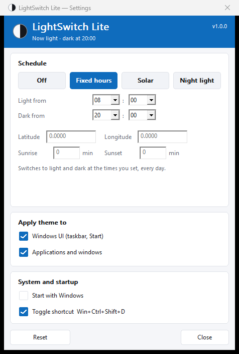

# LightSwitch Lite


[](LICENSE)

Switches the Windows light/dark theme automatically. A single **257 KB** executable
with no installer, no .NET and no dependencies: plain C++ and Win32.



## Features

- **Fixed hours**: light and dark at the times you choose.
- **Sunrise and sunset**: computes each day's solar times from your coordinates.
  No API, no internet.
- **Night light**: follows the Windows Night light state.

- Applies to the **Windows UI** (taskbar, Start) and/or to **apps**.
- Respects your manual changes until the next scheduled time.
- Tray icon, optional start with Windows, and a CLI for scripts.

## Install

Download `LightSwitchLite.exe` from [Releases](../../releases) and run it. No
installation and no administrator rights required.

To also get a Start menu shortcut:

```powershell
powershell -ExecutionPolicy Bypass -File .\install.ps1
powershell -ExecutionPolicy Bypass -File .\install.ps1 -StartWithWindows
powershell -ExecutionPolicy Bypass -File .\install.ps1 -Uninstall
```

Settings live in `HKCU\Software\LightSwitchLite`. The theme is written to the
standard Windows key `HKCU\...\Themes\Personalize`.

## Build

Requires **Visual Studio Build Tools** with the *Desktop development with C++*
workload (MSVC + Windows SDK). No CMake, no .NET.

```powershell
powershell -ExecutionPolicy Bypass -File .\build.ps1
```

Output in `dist\`: `LightSwitchLite.exe` (GUI, 257 KB) and `lsl.exe` (CLI, 145 KB).

## Command line

```powershell
lsl status [--json]     # current state
lsl light               # apply the light theme
lsl dark                # apply the dark theme
lsl toggle              # toggle the theme
lsl mode fixed          # off | fixed | solar | nightlight
lsl --help
```

Exit codes: `0` ok, `1` failure, `2` invalid arguments, `3` the app is not running.

```json
{"version":1,"success":true,"state":{"systemTheme":"dark","appsTheme":"dark","changeSystem":true,"changeApps":true,"scheduleMode":"FixedHours","manualOverride":false}}
```

## Footprint

| Metric | Value |
|---|---|
| Committed memory | ~1.7 MB |
| Resident when idle | ~0.1 MB |
| CPU when idle | 0 % |
| Executable size | 257 KB |

It never polls: the process sleeps and only wakes for the exact time of the next
change, a manual theme change, a system resume, or the CLI.

## Code quality

Compiled with `/W4 /WX /permissive- /std:c++20`: zero warnings, warnings are
errors. The tree is checked with MSVC `/analyze` and exercised under
AddressSanitizer (unit tests and the full app) with no findings. Ownership uses
`std::unique_ptr`, comparisons against command-line switches use
`CompareStringOrdinal` instead of the locale-dependent `lstrcmpiW`.

The project is deliberately plain Win32 with no CMake and no exceptions, so error
codes are used consistently instead of mixing patterns.

## Layout

```
src/settings.cpp  settings in the registry
src/theme.cpp     theme read/write and system notification
src/schedule.cpp  schedule, solar math and next change
src/main.cpp      tray, notifications, IPC
src/ui.cpp        settings window
src/cli.cpp       lsl.exe
```

## Troubleshooting

- **Coordinates do not stick.** They accept a dot or a comma (`-34.6037` or
  `-34,6037`). An unparseable value is rejected and the previous one is kept.
- **The taskbar on a secondary monitor keeps the old colour.** Windows caches the
  taskbar theme per monitor and sometimes misses the repaint. Switch the theme
  again from the tray or with `lsl toggle` to force a repaint.

## Limitations

- Changes the theme of the **current user** only; other profiles are untouched.
- The solar mode uses the **Windows time zone**: enter the coordinates of your own
  location. It does not geolocate.
- In polar latitudes, with no sunrise or sunset it falls back to 08:00–20:00.
- The app must be running for the theme to change on its own.

## License

[MIT](LICENSE)
